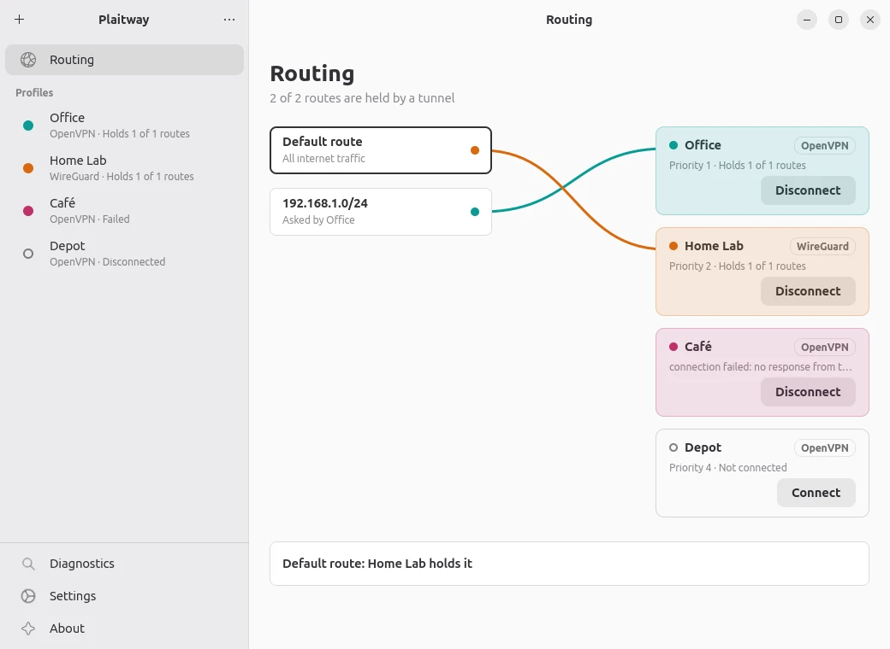

<p align="center">
  
</p>

<h1 align="center">Plaitway</h1>

<p align="center">
  <strong>Several VPNs at once, without them fighting over your routes.</strong><br>
  Run OpenVPN and WireGuard profiles side by side on macOS, Linux and Windows. One
  component owns the routing table and DNS, so a new Wi-Fi network or a changed
  gateway leaves nothing stale behind.
</p>

<p align="center">
  
  
  
  
  
  
  <a href="https://github.com/KoukeNeko/Plaitway/releases/latest"></a>
</p>

<p align="center">
  <a href="#install"><strong>Install</strong></a>
  · <a href="#what-you-get">What you get</a>
  · <a href="#from-the-command-line">Command line</a>
  · <a href="#update-and-uninstall">Update and uninstall</a>
  · <a href="#compatibility">Compatibility</a>
  · <a href="Docs/technical-reference.md">Technical reference</a>
</p>

<p align="center">
  

</p>

<p align="center">
  <picture>
    <source media="(prefers-color-scheme: dark)" srcset="Docs/linux-routing-dark.webp">
    
  </picture>
</p>

Run an office OpenVPN and a personal WireGuard tunnel together, see which one
holds the internet and which one holds `192.168.1.0/24`, and open the window for
the details when something is not working. Every tunnel that is up wants the
default route and the DNS; one Reconciler decides who gets what, writes it down
before it changes anything, and puts it right again after a network change.

## Install

**macOS 15 or later, Apple silicon**

```sh
brew install --cask koukeneko/tap/plaitway
```

The first run offers **Install Helper**; allow it in **System Settings › General › Login Items & Extensions**.

**Windows 11, x64**

```sh
scoop bucket add koukeneko https://github.com/KoukeNeko/scoop-bucket
scoop install koukeneko/plaitway
```

OpenVPN profiles need an OpenVPN installation on the PC; WireGuard profiles need nothing else.

**Ubuntu 24.04 and 26.04, Debian 13**

```sh
sudo curl -fsSL https://koukeneko.github.io/Plaitway/key.asc -o /etc/apt/keyrings/plaitway.asc
echo "deb [signed-by=/etc/apt/keyrings/plaitway.asc] https://koukeneko.github.io/Plaitway stable main" | sudo tee /etc/apt/sources.list.d/plaitway.list
sudo apt update && sudo apt install plaitway
```

**Gentoo with OpenRC:** [Linux without systemd](Docs/technical-reference.md#linux-without-systemd-gentoo-openrc)

Then import a profile (the **+** in the toolbar, a file dropped on the window, or `plaitway import file.ovpn`) and
press **Connect**. A second profile connects the same way; the sidebar order is the priority.

<details>
<summary><strong>Other ways to install</strong></summary>

- **A file from the [latest release](https://github.com/KoukeNeko/Plaitway/releases/latest):** the dmg or zip (macOS; copy
  `Plaitway.app` to `/Applications`), `Plaitway-<version>-x64.msi` (Windows; not signed yet, so SmartScreen asks for
  confirmation), `plaitway_<version>_<arch>.deb` (`sudo apt install ./plaitway_*.deb`)
- **macOS, if SMAppService does not accept the helper:** `sudo scripts/dev-install-daemon.sh` installs it as a plain
  LaunchDaemon
- **macOS, the command line tool without Homebrew:**
  `ln -s /Applications/Plaitway.app/Contents/Resources/bin/plaitway /usr/local/bin/plaitway`
- **Linux with OpenRC, from a checkout without portage:** `make linux-build`, then
  `sudo packaging/linux/install.sh --prefix /usr --openrc` with the `--python-dir` of
  [Linux without systemd](Docs/technical-reference.md#linux-without-systemd-gentoo-openrc)
- **From source:** see [Development](Docs/technical-reference.md#development) and [Release](Docs/technical-reference.md#release)

</details>

## What you get

- **[Several profiles at the same time](Docs/features.md#several-profiles-at-the-same-time).** Each enabled profile gets its own
  tunnel. A full tunnel takes the internet, a split tunnel takes only its prefixes, and where they would collide
  the profile higher in the list wins
- **[Routes and DNS that clean up after themselves](Docs/features.md#routes-and-dns-that-clean-up-after-themselves).** Every route
  is written down before it is added, so a crash, a new gateway or a wake from sleep is repaired and nothing is
  left behind. **Diagnostics** shows what is owned and what is stale
- **[Edit a profile without showing its keys](Docs/features.md#edit-a-profile-without-showing-its-keys).** Private keys appear as
  placeholders until you ask, and the editor marks the line the helper refuses
- **[Connect when the network says so](Docs/features.md#connect-when-the-network-says-so).** Auto-connect, on-demand activation by
  Ethernet or Wi-Fi, and leaving the private ranges out of a WireGuard tunnel
- **[A window, a menu bar item and a command line](#from-the-command-line).** All three talk to the same helper, so
  what you start in one is what the other shows
- **[A helper that is held to a short list](Docs/features.md#know-what-the-helper-may-do).** It listens on a local socket only,
  checks who is calling, and on macOS runs only the OpenVPN it has checked against a hash

## From the command line

`plaitway` talks to the same helper as the app.

| Command | What it does |
|---|---|
| `status [profile]` | State, interface, addresses, uptime and traffic |
| `list` | Profiles with their ids |
| `connect profile` · `disconnect profile` | Switch a profile on or off; `connect` waits until it is up |
| `import file` | Add a profile from an `.ovpn` or a wg-quick `.conf` |
| `show profile` | The profile's text, secrets hidden unless `-secrets` is given |
| `edit profile` | Change the text in `$VISUAL` or `$EDITOR` |
| `set profile` | Change the name and the settings |
| `remove profile` | Disconnect and delete a profile |
| `logs [profile]` | A profile's log, or the helper's own |
| `diagnostics` · `resync` | The network and the owned routes · rebuild them |
| `watch` | Print profile changes as they happen |

## Update and uninstall

| Update | |
|---|---|
| macOS | `brew upgrade --cask koukeneko/tap/plaitway`; when the helper is older than the app, the app offers **Reinstall Helper** |
| Windows | `scoop update plaitway` |
| Ubuntu, Debian | `sudo apt update && sudo apt upgrade` |
| Gentoo | `sudo emerge @live-rebuild`, then `sudo rc-service plaitwayd restart` |

Installed from a file or by hand, install the new one over the old one. A new helper replaces the running one, which
disconnects running profiles; the stored profiles stay. Quit Plaitway and open it again to get the new window.

## Compatibility

- macOS 15 or later on Apple silicon; the window uses the macOS 26 and 27
  design where it exists
- **OpenVPN** profiles (`.ovpn`) over UDP or TCP, with the certificates and keys
  inline or beside the file; a username and password, and a key passphrase,
  are asked for when the profile needs them
- **WireGuard** profiles in wg-quick format (`.conf`), IPv4 and IPv6, with
  `Table = off` honoured. An address with a `/0` prefix, such as the
  `192.168.50.0/0` that ASUS routers write for their LAN, is the default route
  as far as WireGuard is concerned, and the import says so
- Profiles that use `pkcs12` or `secret` are refused, and so are directives
  that run programs or read files outside the profile
- Linux with systemd, Ubuntu 24.04 and 26.04 and Debian 13: a kernel with `/dev/net/tun`,
  `systemd-resolved` for DNS settings, and the distribution's `openvpn` (2.6 or
  later) for OpenVPN profiles; WireGuard profiles run on the embedded
  wireguard-go and need no kernel module. OpenVPN profiles with `dev tap` are
  refused. The app needs GTK 4.14 and libadwaita 1.5, the versions of Ubuntu
  24.04; [Linux](Docs/technical-reference.md#linux) says what was run where. Gentoo with OpenRC installs from the
  live ebuild, with DNS settings for a full tunnel through openresolv:
  [Linux without systemd](Docs/technical-reference.md#linux-without-systemd-gentoo-openrc)

Windows is described under [Windows](Docs/technical-reference.md#windows).

## Documentation

- **[What Plaitway does](Docs/features.md):** the window, several profiles at once, routes and DNS that clean up after themselves, editing a profile, on-demand activation, what the helper may do
- **[Uninstall](Docs/uninstall.md):** macOS and Linux, in order
- **[Technical reference](Docs/technical-reference.md):** architecture, development, release, and the Windows and Linux notes: what was run where, troubleshooting and limitations
- Per platform: [packaging](packaging/README.md), [Linux app](linux/README.md), [Windows app](windows/rust/README.md)

---

## License

[MIT](LICENSE) © KoukeNeko

Third-party components keep their own terms. The bundled ones, including the
GPL source offer for OpenVPN, LZO and LZ4, are listed in
[packaging/THIRD_PARTY_NOTICES.md](packaging/THIRD_PARTY_NOTICES.md). The Linux
package bundles no OpenVPN; its notices list the Go modules in the two programs
(`go run ./packaging/notices -platform linux`).

### Trademarks

OpenVPN is a registered trademark of OpenVPN Inc. WireGuard is a registered
trademark of Jason A. Donenfeld. Apple, macOS and Keychain are trademarks of
Apple Inc. Linux is the registered trademark of Linus Torvalds. Plaitway is not
affiliated with or endorsed by any of them; the names are used only to say which
protocols and which systems it works with.
